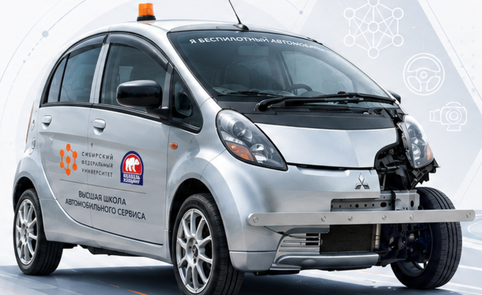
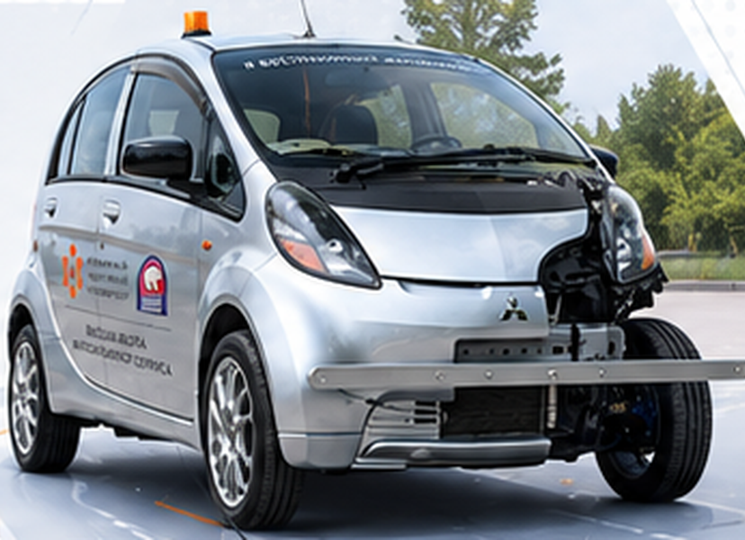
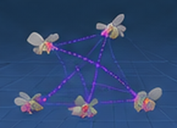

<!--
GitHub profile README for https://github.com/seruyvodoley
To display this on your profile, create a PUBLIC repository named exactly
seruyvodoley/seruyvodoley and put this README and assets/ in its main branch.
The autonomous-driving images come from my original SFU thesis presentation.
The FlySwarm image is a real application screenshot; EvidenceRAG uses an illustrative icon.
-->

<table>
  <tr>
    <td width="54%" valign="middle">
      <h1>Hi, I'm Sergey 👋</h1>
      
<strong>AI Engineer · Software Engineer · Researcher</strong>

      
I build intelligent systems, from <strong>autonomous driving</strong> and <strong>computer vision</strong> to <strong>multi-agent simulations</strong> and <strong>retrieval-augmented applications</strong>. I enjoy turning research ideas into working software and testing them against real-world constraints.

      
🎓 MSc student · Siberian Federal University 
         💼 Teaching Assistant · Department of Software Engineering 
         📍 Krasnoyarsk, Russia

      

        
        
        
      

    </td>
    <td width="46%" valign="middle">
      
    </td>
  </tr>
</table>

---

<table>
<tr>
<td width="64%" valign="top">
<h2>🧰 Core expertise</h2>

</td>
<td width="36%" valign="top">
<h2>🎯 Focus areas</h2>
<ul>
<li>Autonomous systems &amp; perception</li>
<li>Multi-agent modeling &amp; reinforcement learning</li>
<li>RAG, evaluation &amp; source traceability</li>
<li>Applied ML &amp; research software</li>
</ul>
</td>
</tr>
</table>

---

<h2>🚀 Featured projects</h2>

<table>
<tr>
<td width="33%" valign="top">

<h3><a href="https://github.com/lemul4/MitsuNeuroPilotAPI">MitsuNeuroPilotAPI</a></h3>

Research-driven autonomous driving software for the Mitsubishi i-MiEV. Connects CARLA simulation, neural perception and planning to an operator interface and an MCU/CAN vehicle-control pipeline.

<code>Autonomous Driving</code> <code>PyTorch</code> <code>CARLA</code>

Collaborative project · repository hosted by <a href="https://github.com/lemul4">lemul4</a>
</td>
<td width="33%" valign="top">

<h3><a href="https://github.com/seruyvodoley/flyswarm-connectome">FlySwarm</a></h3>

An experimental multi-agent environment integrating Godot, Python, a <em>Drosophila</em> neural-connectome model and reinforcement-learning workflows. Includes a student laboratory for testing and comparing agent strategies.

<code>Multi-Agent AI</code> <code>RL</code> <code>Godot</code>

</td>
<td width="33%" valign="top">

<h3><a href="https://github.com/seruyvodoley/evidencerag">EvidenceRAG</a></h3>

A research prototype for source-grounded document retrieval, document-version comparison and identifying potentially conflicting evidence. Designed with explicit verification limits and reproducible experiments.

<code>Information Retrieval</code> <code>RAG</code> <code>TypeScript</code>

<a href="https://seruyvodoley.gitverse.site/evidencerag/">Live demo ↗</a>
</td>
</tr>
</table>

<a href="https://github.com/seruyvodoley?tab=repositories">View all repositories →</a>

---

<table>
<tr>
<td width="34%" valign="top">
<h2>🎓 Education</h2>

<strong>MSc student</strong> Siberian Federal University 2026 – present

<strong>Bachelor's degree</strong> Siberian Federal University 2026

</td>
<td width="33%" valign="top">
<h2>💼 Experience</h2>

<strong>Teaching Assistant</strong> Department of Software Engineering Siberian Federal University Since September 2026

Practical classes, software engineering and student project work.

</td>
<td width="33%" valign="top">
<h2>🏆 Highlights</h2>
<ul>
<li>Recipient of a RUB 1 million student startup grant for an autonomous-driving project</li>
<li>Research work on real-vehicle integration of an autonomous control model</li>
<li>Building reproducible experimental tools for AI and software engineering</li>
</ul>
</td>
</tr>
</table>

---

<strong>Interested in AI engineering, autonomous systems and research-driven software.</strong> 
<a href="mailto:seruyvodoley@gmail.com">Get in touch</a> · <a href="https://github.com/seruyvodoley?tab=repositories">Explore my code</a>

<!-- The i-MiEV photograph is sourced from an original SFU thesis slide.
The FlySwarm screenshot comes from the public project repository.
The EvidenceRAG visual is a symbolic icon, not a screenshot. -->
